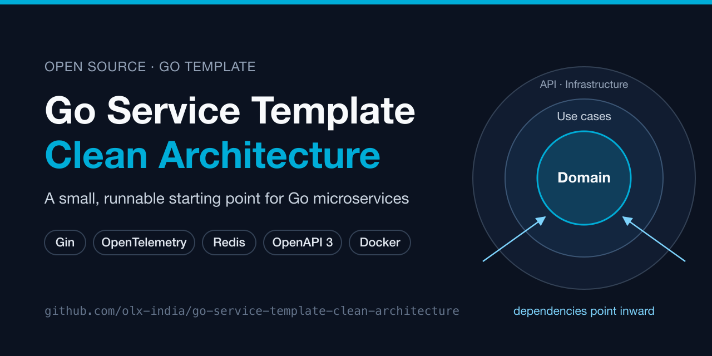
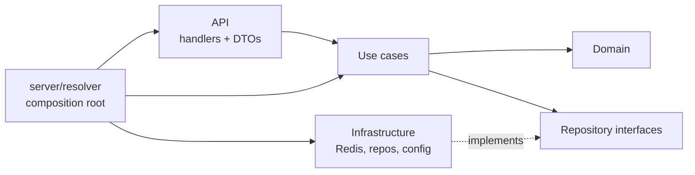

# Go Service Template — Clean Architecture

[](https://github.com/olx-india/go-service-template-clean-architecture/actions/workflows/ci.yml)
[](https://go.dev/dl/)
[](LICENSE)
[](https://pkg.go.dev/github.com/olx-india/go-service-template-clean-architecture)
[](https://goreportcard.com/report/github.com/olx-india/go-service-template-clean-architecture)
[](https://codecov.io/gh/olx-india/go-service-template-clean-architecture)
[](https://github.com/olx-india/go-service-template-clean-architecture/releases)
[](https://olx-india.github.io/go-service-template-clean-architecture/)
[](https://github.com/olx-india/go-service-template-clean-architecture/stargazers)

A small **Go microservice template** built on Clean Architecture: Gin HTTP server, dependency injection, Zap logging, OpenTelemetry tracing, Redis, and OpenAPI 3 with Swagger UI, ready to run with Docker Compose.

**[Create a repository from this template →](https://github.com/olx-india/go-service-template-clean-architecture/generate)** · **[Read the docs →](https://olx-india.github.io/go-service-template-clean-architecture/)**



<!-- TODO: add docs/assets/demo.gif — make compose-up → Swagger UI → Jaeger trace -->

It's a **scaffold**, not a finished product: the layers, wiring, tooling and probes are done, and the sample endpoints show where your business logic goes.

## What you get

| Included and wired | Left for your service |
|--------------------|-----------------------|
| Clean Architecture layers with a single composition root | Business logic in the use cases |
| Gin HTTP server with timeouts and graceful shutdown | Database and migrations |
| Structured JSON logging (Zap) with request and trace IDs | Authentication and authorization |
| Optional OpenTelemetry tracing over OTLP | Metrics |
| Redis client and `/live` + `/ready` probes | Deployment manifests |
| OpenAPI 3 via [go-swagger3](https://github.com/parvez3019/go-swagger3), Swagger UI at `/swagger` | Your domain features |
| Unit and integration tests, mocks, golangci-lint, govulncheck, CI | |

## Quick start

**Everything in Docker** (app, Redis, Jaeger):

```bash
make compose-up
```

**Or the app on your machine** (Go 1.26.11+):

```bash
cp .env.example .env
make run
```

Then:

```bash
curl -s localhost:8080/health
# {"status":"ok","service":"go-service-template"}
```

| Open | For |
|------|-----|
| http://localhost:8080/swagger/index.html | Interactive API docs |
| http://localhost:16686 | Traces in Jaeger (Docker Compose) |

Redis is optional when running locally; without it the service starts and logs a warning. [Getting started](docs/getting-started.md) covers prerequisites, sample requests and common problems.

## Documentation

Browse the guides at **[olx-india.github.io/go-service-template-clean-architecture/](https://olx-india.github.io/go-service-template-clean-architecture/)** or in [`docs/`](docs/):

| Guide | |
|-------|---|
| [Getting started](docs/getting-started.md) | Run it, call it, find your way around |
| [Customizing](docs/CUSTOMIZING.md) | Rename the module and strip the samples |
| [Adding a feature](docs/adding-a-feature.md) | Build an endpoint through every layer |
| [Architecture](docs/architecture.md) | Layers, dependency rule, request lifecycle |
| [Configuration](docs/configuration.md) | Every environment variable |
| [API](docs/api.md) | Endpoints, errors, headers, OpenAPI workflow |
| [Observability](docs/observability.md) | Logs, request IDs, tracing |
| [Testing](docs/testing.md) | Unit and integration tests, mocks, CI |
| [Deployment](docs/deployment.md) | Docker image, probes, production checklist |
| [Extending](docs/EXTENDING.md) | Database, auth, metrics, hardening |

## Architecture



Imports point inward: the domain knows nothing about HTTP or Redis, and use cases depend on interfaces, not clients. Every object is built in one place, `server/resolver/resolver.go`. Read more in [Architecture](docs/architecture.md) and [ADR 001](docs/adr/001-clean-architecture-layers.md).

```
cmd/              entry point
server/           app lifecycle, resolver, router, telemetry
internal/
  domain/         entities and rules
  usecase/        application logic
  api/            HTTP handlers and DTOs
  infrastructure/ config, logger, Redis, repositories
integrationtests/ end-to-end tests against the running app
docs/             guides and the generated OpenAPI spec
```

## How it compares

| | This template | [evrone/go-clean-template](https://github.com/evrone/go-clean-template) | [golang-standards/project-layout](https://github.com/golang-standards/project-layout) |
|---|---|---|---|
| What it is | Minimal runnable HTTP service | Full example app with several transports | Directory layout convention, no runnable service |
| HTTP framework | Gin | Fiber | — |
| Transports | REST | REST, gRPC, RabbitMQ, NATS | — |
| Storage | Redis client (database left to you) | Postgres + migrations | — |
| API docs | OpenAPI 3 (go-swagger3) + Swagger UI | Swagger ([swag](https://github.com/swaggo/swag)) | — |
| Kubernetes probes | `/live` and `/ready` | `/healthz` | — |
| Pick it when | You want a small, readable starting point and add only what you need | You want many integrations wired from day one | You only need folder conventions |

## Make targets

| Command | Does |
|---------|------|
| `make run` | Run the service, exporting `.env` if present |
| `make compose-up` / `compose-down` | Start / stop app, Redis and Jaeger |
| `make test` | Unit and integration tests with the race detector and coverage |
| `make lint` / `make format` | golangci-lint / gofumpt |
| `make vuln` | govulncheck |
| `make swagger` | Regenerate `docs/openapi/oas.json` |
| `make mock` | Regenerate mocks with Mockery |
| `make bin-deps` | Install the pinned dev tools into `./bin` |
| `make pre-commit` | format + lint + test |

Run `make help` for the full list.

## Contributing

Contributions are welcome. See [CONTRIBUTING.md](CONTRIBUTING.md) and the [Code of Conduct](CODE_OF_CONDUCT.md). Questions and ideas go to [Discussions](https://github.com/olx-india/go-service-template-clean-architecture/discussions); issues labelled [`good first issue`](https://github.com/olx-india/go-service-template-clean-architecture/labels/good%20first%20issue) are a good place to start.

Report security issues privately as described in [SECURITY.md](SECURITY.md).

## License

Apache License 2.0 — see [LICENSE](LICENSE).

---

If this template saved you time, please ⭐ the repo or share what you built in [Show and tell](https://github.com/olx-india/go-service-template-clean-architecture/discussions/categories/show-and-tell).
