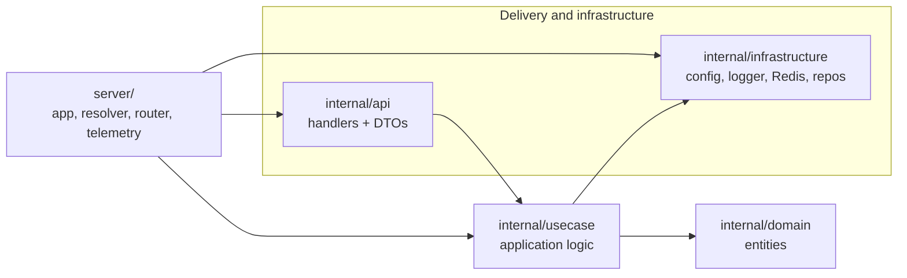
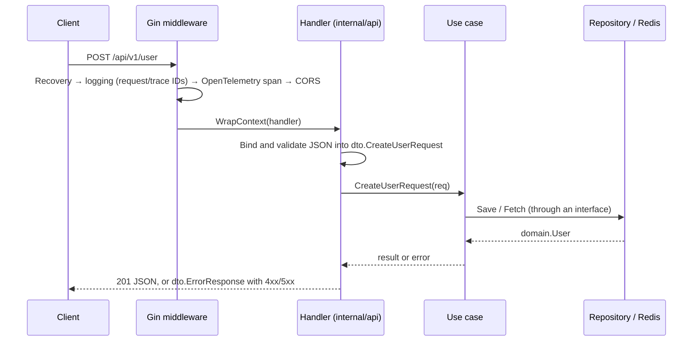

# Architecture

The service follows Clean Architecture: business rules sit in the middle, and HTTP, Redis and other infrastructure sit around them. The reasons for this choice are recorded in [ADR 001](adr/001-clean-architecture-layers.md).

## Layers



| Layer | Package | Holds | May import |
|-------|---------|-------|------------|
| Domain | `internal/domain/<feature>` | Entities and rules, e.g. `user.User`, `user.NewUser` | Standard library only |
| Use case | `internal/usecase/<feature>` | Application logic, one file per operation (`create_user.go`, `fetch_user.go`) | Domain, repository interfaces |
| API | `internal/api`, `internal/api/dto` | Gin handlers, request/response types, OpenAPI annotations | Use case interfaces, DTOs |
| Infrastructure | `internal/infrastructure/...` | Config, logging, Redis provider, repository implementations | Domain, third-party clients |
| Server | `server/...` | Composition root, routes, middleware, HTTP lifecycle, tracing | Everything |

**The dependency rule:** imports point inward. The domain knows nothing about HTTP or Redis; a use case depends on a repository *interface* (`internal/infrastructure/repo/repo.go`), never on a concrete database client.

> **Known gap.** The sample use cases take and return `internal/api/dto` types (for example `IUserUseCase.CreateUserRequest(*dto.CreateUserRequest)`). That makes the use case layer depend on the API layer. When you build real features, give each use case its own input and output types and map DTOs to them in the handler. The domain's `CreateUserInput` shows the pattern.

## Request lifecycle



Middleware is registered in `server/router/router.go`, in this order:

1. `gin.Recovery()` — turns panics into a 500 instead of crashing the process
2. `logger.LoggingMiddleware()` — assigns `X-Request-ID` / `X-Trace-ID` and logs start and end of each request ([Observability](observability.md))
3. `otelgin.Middleware` — starts a trace span per request; a no-op unless tracing is on
4. CORS — allows any origin by default; set `CORS_ALLOWED_ORIGINS` to an explicit comma-separated list before production ([Configuration](configuration.md#variables), [Deployment](deployment.md#production-checklist))

`WrapContext` adapts Gin handlers to `*context.GinContext` (`internal/infrastructure/context`), a thin wrapper that keeps handlers testable and gives you one place to add request-scoped helpers.

## Composition root: the resolver

All objects are built in one place, `server/resolver/resolver.go`. There is no DI framework; the resolver is plain constructor calls:

```go
r.UserHandler = api.NewUserHandler(
    user.NewUserUseCase(r.redisProvider, r.userRepo, r.userWebAPIProvider),
)
```

`ResolveServerContext()` runs these steps in order:

1. **Providers** — connects to Redis. On failure it logs the error and continues with a nil provider.
2. **Repositories** — `persistent.NewUserRepo()` (a stub to replace with your database).
3. **External APIs** — `webapi.NewUserWebAPI()` (a stub for calls to other services).
4. **Server context** — builds use cases and handlers and returns them in `ServerContext`, which the router reads.

Look for `// Adopter:` comments: they mark the places you are expected to change.

## Application lifecycle

`server/app/app.go`:

1. Initializes tracing (`server/telemetry`) when `OTEL_ENABLED=true`.
2. Resolves dependencies and registers routes.
3. Starts the HTTP server with the configured read and write timeouts.
4. Waits for `SIGINT` or `SIGTERM`, then shuts down gracefully: in-flight requests get up to **30 seconds**, then the Redis client is closed and buffered spans are flushed.

## Where to put new code

| You are adding… | Put it in |
|-----------------|-----------|
| A business rule or entity | `internal/domain/<feature>/` |
| An operation (create order, refund payment) | `internal/usecase/<feature>/<operation>.go` |
| An HTTP endpoint | Handler in `internal/api/`, types in `internal/api/dto/`, route in `server/router/router.go` |
| A database or external client | Interface in `internal/infrastructure/repo/`, implementation in a subpackage |
| Wiring | `server/resolver/resolver.go` |
| Cross-cutting middleware (auth, metrics) | `server/router/` |

[Adding a feature](adding-a-feature.md) walks through all of these with an example.
