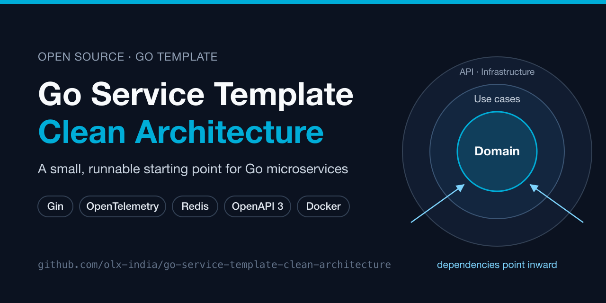
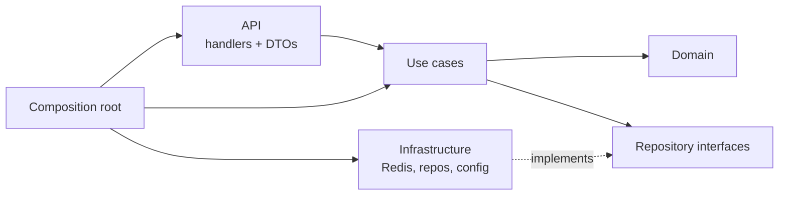

# Go Service Template

**A small, runnable starting point for Go microservices, built on Clean Architecture.**

Gin HTTP server, dependency injection, structured logging, OpenTelemetry tracing, Redis, health probes and OpenAPI 3 with Swagger UI: wired, tested and ready to run with one command.

[Get started](getting-started.md){ .md-button .md-button--primary }
[Use this template](https://github.com/olx-india/go-service-template-clean-architecture/generate){ .md-button }
[View on GitHub](https://github.com/olx-india/go-service-template-clean-architecture){ .md-button }



## Run it in one command

```bash
git clone https://github.com/olx-india/go-service-template-clean-architecture.git
cd go-service-template-clean-architecture
make compose-up
```

The app is on `http://localhost:8080`, Swagger UI on `/swagger/index.html`, and Jaeger traces on `http://localhost:16686`.

## What's included

| Included and wired | Left for your service |
|--------------------|-----------------------|
| Clean Architecture layers with a single composition root | Business logic in the use cases |
| Gin HTTP server with timeouts and graceful shutdown | Database and migrations |
| Structured JSON logging (Zap) with request and trace IDs | Authentication and authorization |
| Optional OpenTelemetry tracing over OTLP | Metrics |
| Redis client and `/live` + `/ready` probes | Deployment manifests |
| OpenAPI 3 via go-swagger3, Swagger UI at `/swagger` | Your domain features |
| Unit and integration tests, mocks, golangci-lint, govulncheck, CI | |

## How it's organized



Imports point inward: the domain knows nothing about HTTP or Redis, and use cases depend on interfaces rather than clients. [Read the architecture guide](architecture.md).

## Where to go next

| If you want to… | Read |
|-----------------|------|
| Run it and send your first requests | [Getting started](getting-started.md) |
| Turn it into your own service | [Customizing](CUSTOMIZING.md) |
| Add an endpoint the right way | [Adding a feature](adding-a-feature.md) |
| Look up a setting | [Configuration](configuration.md) |
| See the API contract | [API](api.md) · [Swagger UI](openapi/index.html) |
| Ship it | [Deployment](deployment.md) |

## How it compares

| | This template | [evrone/go-clean-template](https://github.com/evrone/go-clean-template) | [golang-standards/project-layout](https://github.com/golang-standards/project-layout) |
|---|---|---|---|
| What it is | Minimal runnable HTTP service | Full example app with several transports | Directory layout convention, no runnable service |
| HTTP framework | Gin | Fiber | — |
| Transports | REST | REST, gRPC, RabbitMQ, NATS | — |
| Storage | Redis client (database left to you) | Postgres + migrations | — |
| API docs | OpenAPI 3 (go-swagger3) + Swagger UI | Swagger (swag) | — |
| Pick it when | You want a small, readable starting point | You want many integrations wired from day one | You only need folder conventions |

---

Open source under the Apache 2.0 license. If it saves you time, [star it on GitHub](https://github.com/olx-india/go-service-template-clean-architecture) or share what you built in [Show and tell](https://github.com/olx-india/go-service-template-clean-architecture/discussions/categories/show-and-tell).
